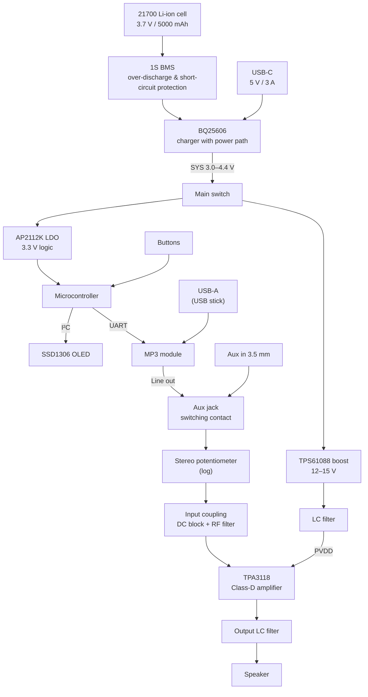

# SoundCube

A battery-powered DIY music box with a Class-D amplifier, USB-C charging, MP3 playback from a USB stick, an Aux input and a small OLED display. Schematic and PCB designed in KiCad.

> **Status:** Work in progress. Schematic and PCB layout are under active development; firmware and enclosure will follow.

<!-- Add a render or photo here once available, e.g.:

-->

## Features

- **Class-D amplifier** based on the TI TPA3118 for high efficiency on battery power
- **Single 21700 Li-ion cell** (Samsung INR21700-50S, 5000 mAh) with BMS protection
- **USB-C charging** via TI BQ25606 buck charger with power path, so the box can play while charging
- **MP3 playback** from a FAT32 USB stick via an MP3 decoder module
- **Aux input** (3.5 mm jack) that mechanically disconnects the MP3 source when a cable is plugged in
- **Analog volume control** with a logarithmic stereo potentiometer
- **OLED display** (SSD1306, 128×64) and push buttons for play/pause, next and previous
- **Microcontroller** for user interface and player control

## System overview



## Hardware

| Block | Component | Purpose |
|---|---|---|
| Battery | Samsung INR21700-50S | 3.7 V nominal, 5000 mAh energy storage |
| Protection | 1S Li-ion BMS | Over-discharge and short-circuit protection |
| Charger | TI BQ25606 | USB-C charging with power path (NVDC) |
| Logic supply | AP2112K-3.3 | 3.3 V LDO for microcontroller and display |
| Amplifier supply | TI TPS61088 | Synchronous boost converter, 12–15 V for the amplifier |
| Amplifier | TI TPA3118 | Class-D power amplifier |
| Display | SSD1306 | 128×64 OLED via I²C |
| Audio source | MP3 module + USB-A | Playback from FAT32 USB stick |

### Design notes

- **Separate supply rails:** The amplifier runs from a boosted 12–15 V rail to get more output power from a single cell, while the logic runs from a clean 3.3 V LDO.
- **Supply filtering:** An LC filter after the boost converter reduces switching noise on the amplifier supply.
- **Grounding:** Digital ground (MCU, display), analog ground (audio path, potentiometer, Aux) and power ground (boost converter, amplifier) are kept separate and joined at a single star point near the charger's main capacitor to keep switching currents out of the audio path.
- **Amplifier fault monitoring:** The TPA3118 fault output (open-drain) is read by the microcontroller using its internal pull-up.

## Repository structure

```
SoundCube/
├── PCB/            KiCad project (schematics, layout)
│   └── lib/        Custom symbols, footprints and 3D models
├── LICENSE
└── README.md
```

The schematic is split into several sheets: power supply, amplifier and microcontroller.

## Opening the project

1. Clone the repository
2. Open `PCB/PCB.kicad_pro` in a recent version of KiCad
3. Custom libraries are included in `PCB/lib/` and referenced relative to the project, so no extra setup is needed

## License

This project is licensed under the MIT License. See [LICENSE](LICENSE) for details.
